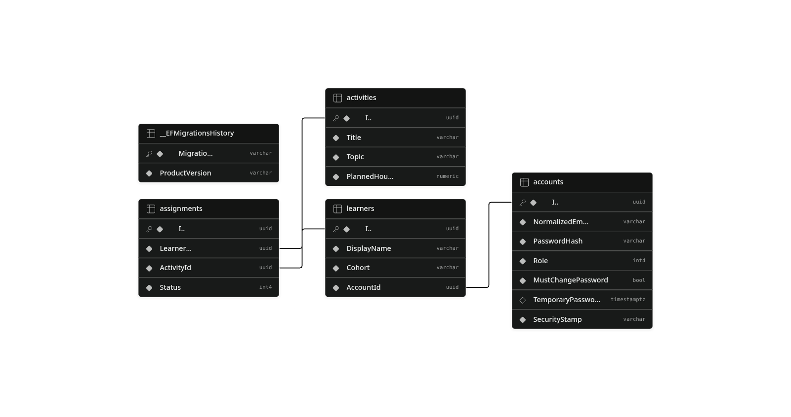

# Learning Tracker

A web application for managing learners, learning activities, and
assignments. It provides a Coordinator-facing dashboard and allows
learners to track the activities assigned to them.

## Tech Stack

- ASP.NET Core MVC (.NET 10)
- C#
- Entity Framework Core
- Supabase (PostgreSQL database)
- Razor Views, HTML, CSS, and JavaScript

## Project Structure

The solution is split into multiple projects to separate
responsibilities:

| Project | Purpose |
|---|---|
| `LearningTracker.Web` | MVC controllers, Razor views, and web application configuration |
| `LearningTracker.Services` | Application business logic |
| `LearningTracker.Repositories` | Database access and repository implementations |
| `LearningTracker.Data` | Entity Framework Core database context and database configuration |
| `LearningTracker.Models` | Shared entities and enums |

## Features

- **Authentication:** Sign in and sign out using cookie-based authentication.
- **Role-based access:** Separate access for Coordinators and Learners.
- **Password management:** Supports password changes and temporary-password handling.
- **Coordinator dashboard:** Displays learner, activity, and assignment statistics, including cohort progress.
- **Learner management:** Create and manage learner accounts.
- **Activity management:** Create, view, and edit learning activities.
- **Assignment management:** Assign activities to learners and track assignment status.
- **Learner progress:** Learners can view their assignments and update their progress.
- **CSV import and export:** Download an activity import template, import activities from CSV, and export existing activities to CSV.

## Application Modules

- **Account:** Handles user credentials, roles, authentication, and password-related state.
- **Learner:** Manages learner profiles and their cohort information.
- **Activity:** Manages learning activities, including their title, topic, and planned hours.
- **Assignment:** Connects learners with activities and tracks each assignment's progress status.
- **Dashboard:** Provides Coordinator-facing statistics and cohort progress information.

## Entity Relationships

The application uses four main entities: `Account`, `Learner`, `Activity`, and `Assignment`.

- **Account–Learner (one-to-one):** An account can be associated with one learner profile. A Coordinator account does not require a learner profile. Each learner profile belongs to one account.
- **Learner–Assignment (one-to-many):** A learner can have multiple assignments. Each assignment belongs to one learner.
- **Activity–Assignment (one-to-many):** An activity can be assigned to multiple learners through assignment records. Each assignment references one activity.
- **Learner–Activity (many-to-many through Assignment):** The `Assignment` entity connects learners and activities and stores the status of each assignment.

A unique constraint on `Assignment.LearnerId` and `Assignment.ActivityId` prevents the same activity from being assigned to the same learner more than once. The relationships are configured with cascade delete behavior for the related learner and activity records.

## Entity Relationship Diagram



## Prerequisites

Make sure the following are installed:

- .NET 10 SDK
- Access to a Supabase project with a PostgreSQL database
- An IDE or editor such as Visual Studio or Visual Studio Code

## Configuration

Before running the application, configure the following settings.

### Supabase PostgreSQL Connection String

The application uses Supabase as its database provider. Supabase provides a managed PostgreSQL database.

Update `DefaultConnection` in your local configuration file, such as
`appsettings.Development.json`, using the connection details from your
Supabase project:

```json
{
  "ConnectionStrings": {
    "DefaultConnection": "Host=YOUR_SUPABASE_HOST;Port=5432;Database=postgres;Username=YOUR_USERNAME;Password=YOUR_PASSWORD"
  },
  "Scheduler": {
    "HealthUrl": "http://localhost:5272/health"
  },
  "COORDINATOR_REGISTRATION_SECRET": "YOUR_SECRET"
}
```

Replace the connection string placeholders with the values provided by
Supabase. Use the connection method and SSL settings recommended for your
Supabase project. Set `Scheduler:HealthUrl` to the health endpoint of the
scheduler service you are using.

The scheduler setting can also be supplied as an environment variable:

```text
Scheduler__HealthUrl
```

In ASP.NET Core configuration, the double underscore (`__`) represents a
colon (`:`). Therefore, `Scheduler__HealthUrl` overrides the
`Scheduler:HealthUrl` setting in `appsettings.json`.

### Coordinator Registration Secret

Set the following environment variable:

```text
COORDINATOR_REGISTRATION_SECRET
```

This value is used as the shared registration secret on the Coordinator
registration page. Do not commit real secrets or database passwords to
the repository.

## Run Locally

1. Clone the repository:

   ```bash
   git clone https://github.com/s-sammm-y/LearningProgressTracker
   cd LearningProgressTracker
   ```

2. Restore the dependencies:

   ```bash
   dotnet restore
   ```

3. Configure the Supabase PostgreSQL connection string, the
   `Scheduler__HealthUrl` environment variable (if configuring the
   scheduler URL through the environment), and the
   `COORDINATOR_REGISTRATION_SECRET` environment variable.

4. Run the MVC application:

   ```bash
   dotnet run --project LearningTracker.Web
   ```

5. Open the local URL shown in the terminal.

The application is configured to apply pending Entity Framework Core
migrations during startup. Make sure the Supabase database is reachable
and the connection details are valid. Also make sure the scheduler health
URL points to the scheduler service's health endpoint.

## Demo Note: Coordinator Account Creation

Coordinator self-registration is included **for demonstration and
testing purposes only**.

To create a Coordinator account:

1. Set the `COORDINATOR_REGISTRATION_SECRET` environment variable.
2. Open the Coordinator registration page at `/Coordinator/Register`.
3. Enter an email address, password, and the configured registration
   secret.
4. Submit the form. If the details and secret are valid, the
   Coordinator account is created.
5. Go to the login page and sign in using the newly created
   credentials.

The registration secret is checked by the application before the account
is created. The new account is assigned the `Coordinator` role, and its
password is stored as a hash.

This is a demo registration mechanism, not a production-ready
Coordinator onboarding process. In a production system, Coordinator
account creation should be restricted to an authorized administrative
process, and the registration secret should not be distributed publicly.
